# REDLINE · 曼岛死亡边缘

一个**单文件、零依赖、无需构建**的浏览器第一人称摩托车竞速游戏。

**🎮 在线试玩（GitHub Pages）：https://xuxiaodong915.github.io/redline/**

- **仓库**：https://github.com/xuxiaodong915/redline
- 单文件版也可直接下载仓库根目录的 `index.html` 离线游玩。

灵感来自曼岛 TT 山路赛和 [deathchase-3d](https://github.com/red-reddington/web-demos) 那种贴着地面高速狂奔的街机感：没有缓冲区，只有石墙、湿路、越跑越窄的走线和一台被逼到红区的直列四缸。

双击 `index.html` 即可开始，不需要服务器、不需要联网、也不需要安装任何东西。

> 建议佩戴耳机。点击「点火出发」后会解锁 WebAudio 引擎声；浏览器要求首次声音必须来自用户点击。

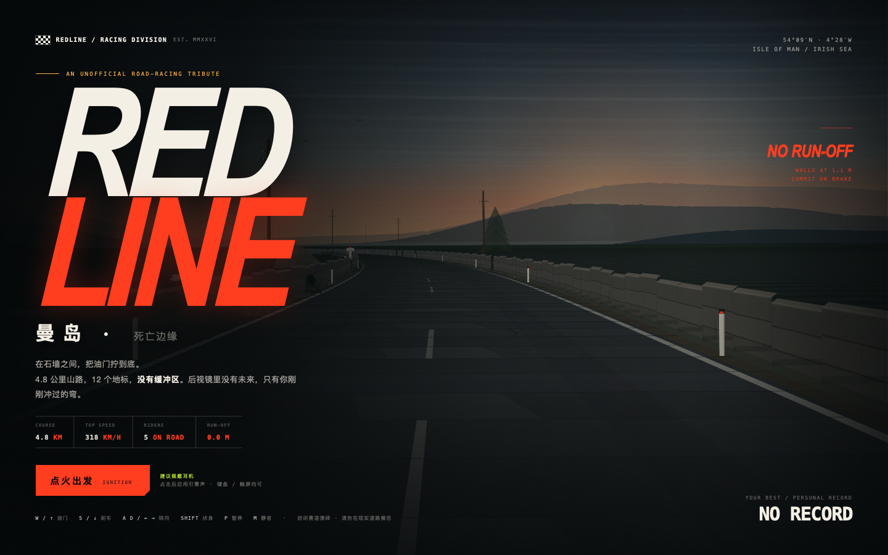

## 玩法

- **4.8 公里**曼岛风格的封闭山路，从 TT Grandstand 出发，经过 **12 个地标**：Bray Hill → Quarter Bridge → Union Mills → Ballaugh Bridge → Sulby Glen → The Mountain → Mountain Mile → Kate's Cottage → Creg-ny-Baa → Governor's Dip → Finish。
- 和 4 位 AI 车手同场竞速，起跑时你在最后；追上去，用更晚的刹车和更窄的走线超车。
- **没有缓冲区**：石墙就在路边。低速蹭墙只会掉速，高速碰墙会直接 Wipeout。
- **赛道越窄，速度越吓人**：高速弯会把你向石墙推，必须收油、刹车、压弯；伏身（Tuck）可以减小风阻，把表底逼到 318 km/h 以上。
- **Ballaugh Bridge 跳跃**：速度够快时前轮会离地，落地会震到车把和镜头。
- 分段计时、Sector 提示、个人最佳成绩、近身擦墙「MILLIMETRES」提示、Top Speed 记录。
- 每个赛段结束保存总成绩；下次打开标题页会显示个人最佳。

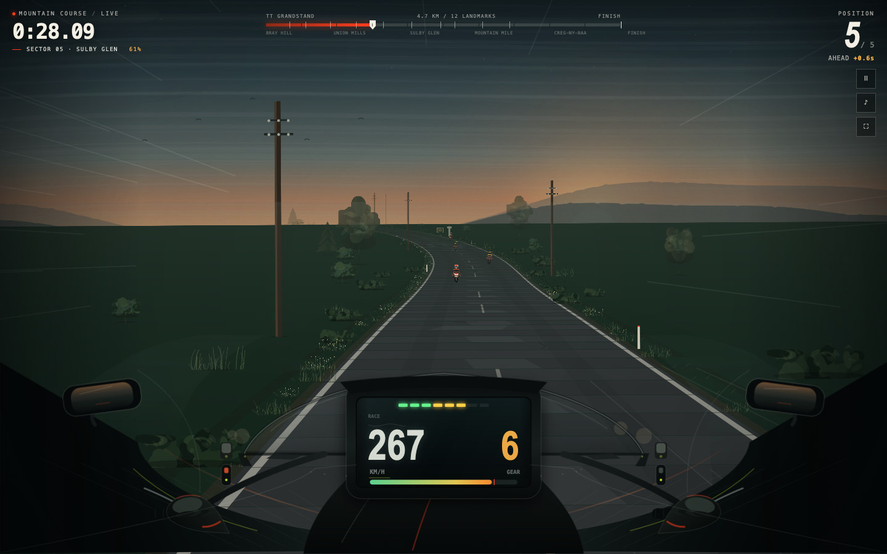

## 操作

| 按键 | 功能 |
| --- | --- |
| `W` / `↑` | 油门 |
| `S` / `↓` | 刹车 |
| `A` `D` / `←` `→` | 转向 |
| `Shift` | 伏身 / Tuck |
| `P` / `Esc` | 暂停 / 继续 |
| `M` | 静音 / 开启声音 |
| `R` | 重新开始 |
| `F` | 全屏（桌面） |
| `Enter` | 开始 / 结算后重开 |

移动端横屏进入后会出现触屏按钮：左侧转向、右侧油门 / 刹车、右上方 TUCK、左侧 PAUSE。暂停界面里也可以调整声音与全屏。

## 声音

全部声音都由代码实时合成，没有音频文件：

- 直列四缸谐波引擎声，跟随转速、油门、挡位变化；升挡有断火和回火，降挡有补油；
- 进气/排气噪声、限转断油抖动、风噪、胎噪、链条啸叫；
- 撞墙的金属冲击、近身擦墙的风切声、发车倒计时提示音。

想单独试听/调试声浪，打开 [audio-lab.html](audio-lab.html)：里面有独立的转速、油门、挡位、刹车、伏身、限转和撞击按钮。

## 技术

- **单文件**：`index.html` 约 210 KB，内含全部 HTML/CSS/JS、Canvas 2D 渲染器与 WebAudio 引擎，不含任何外部图片、字体、音频或依赖。
- **伪 3D 赛道**：逐段投影的弯道、坡度、石墙/树篱、房屋、看台、电话线杆、地标牌、人群、跳桥、湿路反射、雨丝、速度线、暗角与镜头震动。
- **第一人称车把 HUD**：TFT 屏、转速灯、挡位、Tuck 状态、离心力与车把抖动。
- **物理**：自动变速箱、扭矩/风阻/刹车、草地减速、撞墙判定、跳桥离地、近身擦墙、AI 走线/刹车/避让/胶着。
- **WebAudio 合成**：8 振荡器谐波堆、滤波噪声、压缩器与限幅器，所有参数平滑过渡。
- 响应式：桌面 16:9、手机横屏与竖屏均可；触屏自动隐藏桌面系统按钮，把控制交给屏幕按钮。

| 倒计时 | Ballaugh Bridge |
| --- | --- |
| 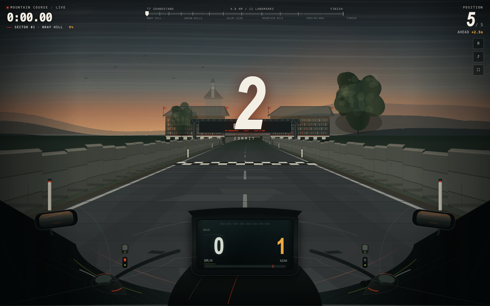 | 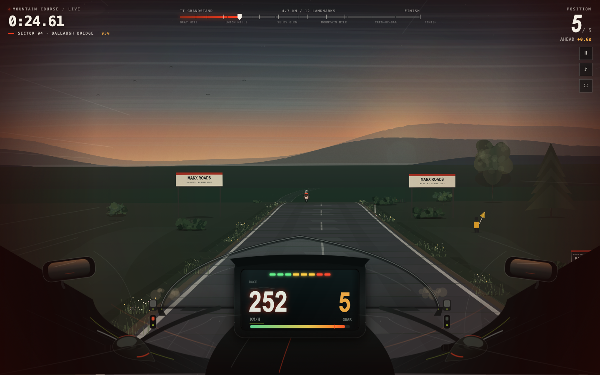 |

| Mountain Mile | 冲线 |
| --- | --- |
| 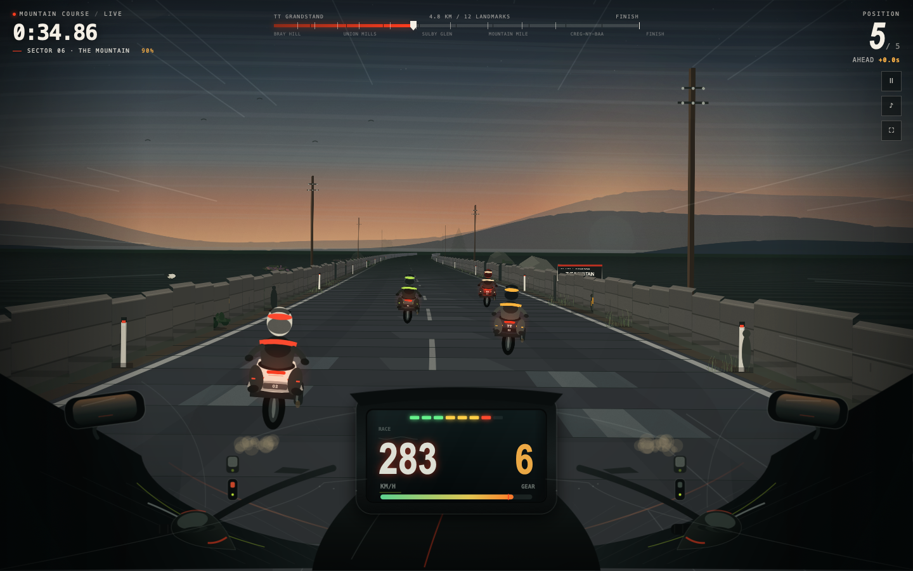 | 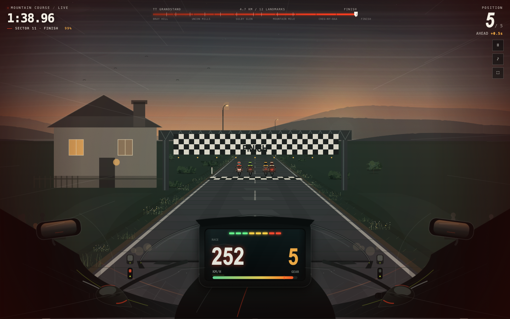 |

| 暂停 | 撞墙 |
| --- | --- |
| 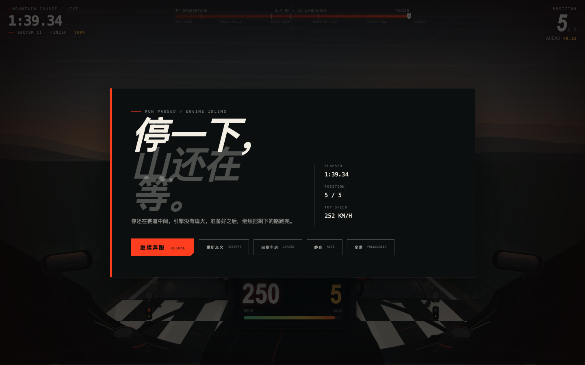 | 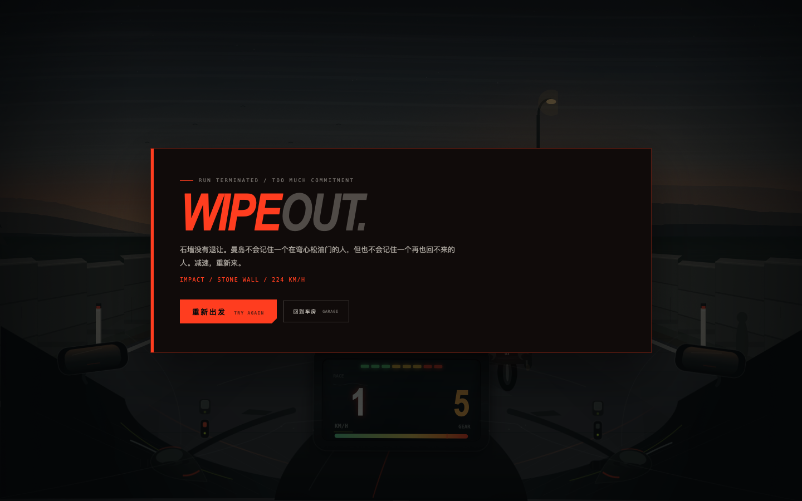 |

| 结算 | 手机横屏 |
| --- | --- |
| 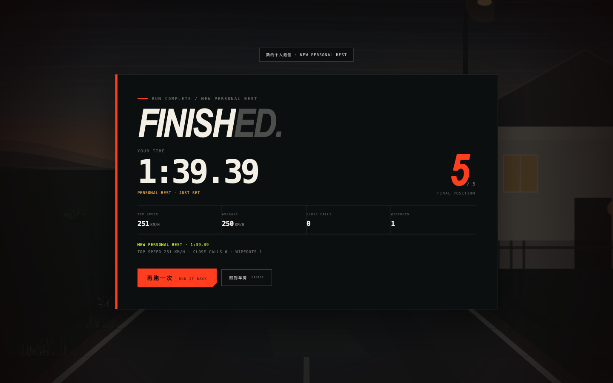 | 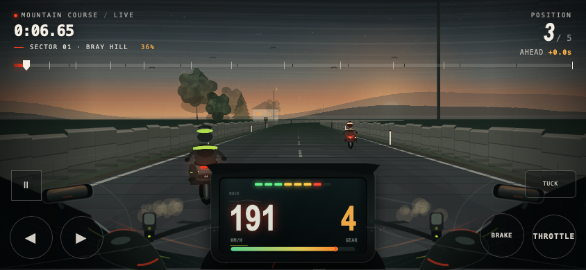 |

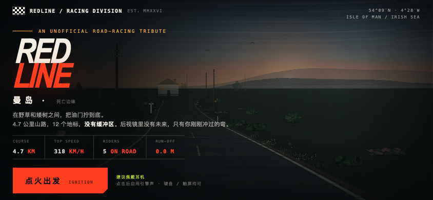

## 文件

- `index.html` — 最终可玩的单文件游戏（双击即可）
- `screenshots/` — 游戏截图
- `audio-lab.html` — 独立声浪试听台
- `audio-engine.js` — 声浪合成引擎源码（`index.html` 中已内联一份）
- `README.md` — 本说明
- `docs/` — GitHub Pages 发布目录（`docs/index.html` 与根目录保持一致）
- `qa-report.md` — 独立 QA 报告

## 本地运行

直接双击 `index.html`。如果浏览器对 `file://` 有限制，也可以：

```bash
cd tt-death-ride
python3 -m http.server 8765
# 打开 http://localhost:8765/index.html
```

## 调试 API

为了方便自动化测试，游戏暴露了 `window.REDLINE`：`state`、`speed`、`distance`、`rank`、`landmarks`、`rivals`、`step(n, dt)` 等。`step` 可以不依赖 `requestAnimationFrame` 推进模拟，在无头测试环境很有用。

## 测试

- 独立 QA 在真实 WebKit 渲染器与 jsdom 模拟器中跑过完整流程，覆盖桌面、手机横屏 / 竖屏、键盘 / 触屏、暂停、静音、撞车、结算、重开、localStorage 最佳成绩与 file:// 加载；没有未捕获 JS 错误。
- 详细报告与复现记录见 [qa-report.md](qa-report.md)。

## 更新线上版本

GitHub Pages 当前从 `main` 分支的 `docs/` 目录发布。修改根目录 `index.html` 后，同步副本再推送：

```bash
cp index.html docs/index.html
git add -A
git commit -m "update build"
git push origin main
```

## 免责声明

这是一个**非官方同人作品**，用于前端/游戏开发学习。Manx 地名与 TT 赛事相关名称属于其各自权利人；游戏中的车手、车队与成绩均为虚构。请在封闭环境或游戏中体验速度，**请勿在现实公共道路上模仿任何危险驾驶行为**。
